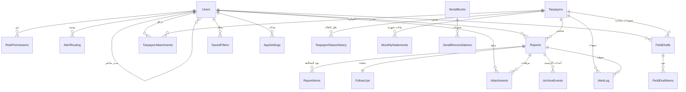

# مخطط قاعدة البيانات (ERD)

مخطط علائقي مقترح لـ **SQL Server** لنظام دائرة الإنفاق الاستهلاكي. التطبيق الحالي تجريبي ويحفظ في المتصفح، وهذا المخطط هو هدف الانتقال إلى الخلفية. ملف التنفيذ الكامل: [`docs/schema.sql`](schema.sql).

## المخطط العام

## الجداول

### المستخدمون والصلاحيات
| الجدول | الغرض | الحقول المفتاحية |
|---|---|---|
| `Users` | حسابات الموظفين | `Id`, `Username`, `PasswordHash`, `Role`, `Division`, `ManagerId`, `Active` |
| `RolePermissions` | صلاحيات كل دور | `Role`, `Permission` |
| `AlertRouting` | جهة استلام كل نوع تنبيه | `AlertType`, `Target` (`role:x` / `div:x` / `user:id`) |

### المكلفون
| الجدول | الغرض | الحقول المفتاحية |
|---|---|---|
| `Taxpayers` | سجل المنشآت | `Id`, `Name`, `Owner`, `Category`, `TaxNo` (فريد), `Address`, `Profession`, `Status` |
| `TaxpayerStatusHistory` | سجل تغيّر الحالة | `TaxpayerId`, `ChangedAt`, `FromStatus`, `ToStatus`, `Reason`, `ChangedBy` |
| `MonthlyStatements` | البيانات الشهرية | `TaxpayerId` + `Ym` (YYYY-MM), `Submitted`, `SubmittedOn` |
| `TaxpayerAttachments` | صور أضبارة المكلف | `TaxpayerId`, `StoragePath`, `Sha256`, `Note` (نوع الورقة), `DeletedAt` |

### المحاضر والمخالفات
| الجدول | الغرض | الحقول المفتاحية |
|---|---|---|
| `Reports` | المحضر | `Id`, `Serial` (فريد), `TaxpayerId`, `IssuedAt`, `Status`, `Total`, `Fingerprint`, `ArchiveRef` |
| `ReportItems` | بنود المخالفة | `ReportId`, `Type`, `Article`, `Fine` |
| `FollowUps` | بيانات المتابعة | `ReportId`, `Data` (JSON) |
| `Attachments` | مرفقات المحضر | `ReportId`, `StoragePath`, `Sha256`, `DeletedAt` |
| `ArchiveEvents` | أحداث الأرشيف | `ReportId`, `EventType` (locate/checkout/return/destroy), `ByUser`, `AtTime` |
| `SerialBooks` | دفاتر الأرقام التسلسلية | `FromNo`, `ToNo`, `Assignee`, `Closed` |
| `SerialReconciliations` | تسويات الأرقام | `BookId`, `No`, `Reason` |

### العمل الميداني
| الجدول | الغرض |
|---|---|
| `FieldDrafts` | مسودات المحاضر من أجهزة المفتشين (`DraftId` يمنع التكرار، `Status`, `Lat/Lng`, `PayloadJson`) |
| `FieldDraftItems` | بنود مسودة المحضر |
| `FieldSyncLog` | سجل محاولات المزامنة والنتيجة |

### السجلات والإعدادات
| الجدول | الغرض |
|---|---|
| `AuditLog` | سجل عمليات متسلسل بالبصمات (إضافة فقط) |
| `AlertLog` | التنبيهات والمواعيد وحالة قراءتها |
| `SavedFilters` | فلاتر قائمة المكلفين المحفوظة |
| `AppSettings` | إعدادات النظام (`SettingKey` / `Value`) |

## القيود والحماية (Triggers)

- `trg_AuditLog_ReadOnly`: منع UPDATE/DELETE على سجل العمليات.
- `trg_Reports_NoDelete`: منع حذف المحضر نهائياً (الإلغاء بسبب مكتوب فقط).
- `trg_Reports_Locked`: منع تعديل الحقول الجوهرية بعد قفل المحضر (`Serial`, `TaxpayerId`, `Total`, `Fingerprint`, `IssuedAt`, `ServedName`).
- `trg_Attachments_NoDelete` و`trg_TaxpayerAttachments_NoDelete`: منع الحذف النهائي، والاعتماد على `DeletedAt` (حذف ناعم).
- حدود الحجم: مرفق المحضر ≤ 5MB، وصورة الأضبارة ≤ 1.5MB.

## الفهارس

- `IX_Reports_Archive` على `(ArchiveRef, ArchiveBox)`.
- `IX_Attachments_Report` و`IX_TaxpayerAttachments_Taxpayer` (مفلترة بـ `DeletedAt IS NULL`).
- `IX_FieldDrafts_Status` على `(Status, UpdatedAt)`.
- `IX_AlertLog_Time` على `AtTime DESC`.

## ملاحظات

- الملفات لا تُحفظ في القاعدة: يُحفظ الوصف و`StoragePath` و`Sha256` فقط.
- حالة المكلف ثلاثية: `فعال` · `متوقف مؤقتاً` · `متوقف نهائياً`، وتُستخدم في بطاقات لوحة التحكم.
- بصمة المحضر (`Fingerprint`) مستقلة عن حقول الأرشيف والمرفقات، فلا يتأثر توقيع المحضر بإضافة صورة أو موقع أرشيفي.
